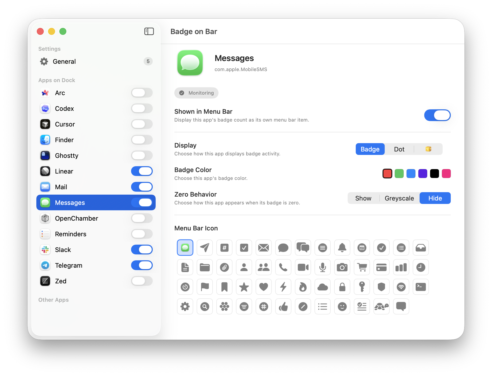

# Badge On Bar

<p align="center">
  
</p>

Badge On Bar is a small native macOS app that mirrors the badge counts from apps in your Dock into the menu bar, one menu bar item per app you choose. It is a rewrite of the fantastic [Doll](https://github.com/xiaogdgenuine/Doll) project.

Learn more at [badgeonbar.com](https://badgeonbar.com).

## Install

```sh
brew install grahamotte/tap/badge-on-bar
```

Update with `brew upgrade`. To install by hand instead, download the latest zip from [Releases](https://github.com/grahamotte/BadgeOnBar/releases), unzip it, and move the app to `/Applications`. Builds are signed with a Developer ID and notarized by Apple.

Badge On Bar requires macOS 26.2 or later.

## Using Badge On Bar

### First launch

Badge On Bar reads badges from the Dock through the macOS Accessibility API, so it needs Accessibility access. On first launch macOS asks for it, and the Badge On Bar window shows **Accessibility Access Required**. Click **Open System Settings**, turn Badge On Bar on under Privacy & Security → Accessibility, and come back; the window switches to the settings view on its own. If you later turn access off, Badge On Bar stops reading badges until you turn it back on.

Badge On Bar shows a Dock icon only while its window is open. Closing its window removes the Dock icon and leaves it running in the menu bar. To bring the window back, open Badge On Bar again, or right-click any of its menu bar items and choose **Settings…**.

### Choosing apps

The sidebar lists **Apps on Dock** (apps pinned to or running in the Dock) and, collapsed below them, **Other Apps** (apps in `/Applications`, `/System/Applications`, and `~/Applications`). Flip the switch next to an app, or select it and turn on **Show in Menu Bar**, to give it its own menu bar item. Badges are read from the Dock, so an app only shows a count while it is in the Dock.

Until you pick any apps, Badge On Bar shows a single item with its own icon. Click it to open the settings window.

### Menu bar items

- **Click** an item to open or switch to that app.
- **Option-click** an item to open Badge On Bar's settings.
- **Right-click** an item for a **Settings…** menu.
- Hover over an item to see the app's name and count.

Counts update about once a second. Hold Command and drag to reorder the items; macOS remembers their positions.

### Per-app options

Select an app in the sidebar to change how its item looks:

| Option | Choices |
| --- | --- |
| Display | **Badge**: a colored circle with the count over the icon, capped at 99. **Dot**: a small colored dot in the icon's corner. **Count**: the full number as text next to the icon. **Question block** (the last segment): the icon turns into a question block whenever the app has a badge. |
| Badge Color | Red, green, blue, purple, black, or pink, used for the Badge and Dot displays |
| Zero Behavior | What the item does when the count is zero: **Show** it as usual, **Greyscale** the app icon, or **Hide** the item until a badge appears |
| Menu Bar Icon | The app's own icon, or one of a set of monochrome symbols |

Some apps show a badge without a number. Badge On Bar shows those as a circle with a dot in Badge mode and as `·` in Count mode.

### General settings

Select **General** at the top of the sidebar for:

- **Start at Login**: launch Badge On Bar when you sign in.
- **Default Display**: the Display, Badge Color, and Zero Behavior that newly chosen apps start with. **Set All** applies a default to every app you have already chosen.
- **Debug**: the number buttons show that badge on every menu bar item for three seconds (`-1` is a badge without a number), so you can preview your settings. **Reset Config** clears your chosen apps and restores every setting to its default.

### Uninstall

Badge On Bar has no Quit menu item, so quit it with `killall BadgeOnBar` or from Activity Monitor, then run `brew uninstall --zap badge-on-bar`, which also removes its preferences. If you installed it by hand, move it to the Trash and delete `~/Library/Preferences/com.grahamotte.badgeonbar2.plist`.

## Contributing

Issues welcome.

## License

[MIT](LICENSE)
